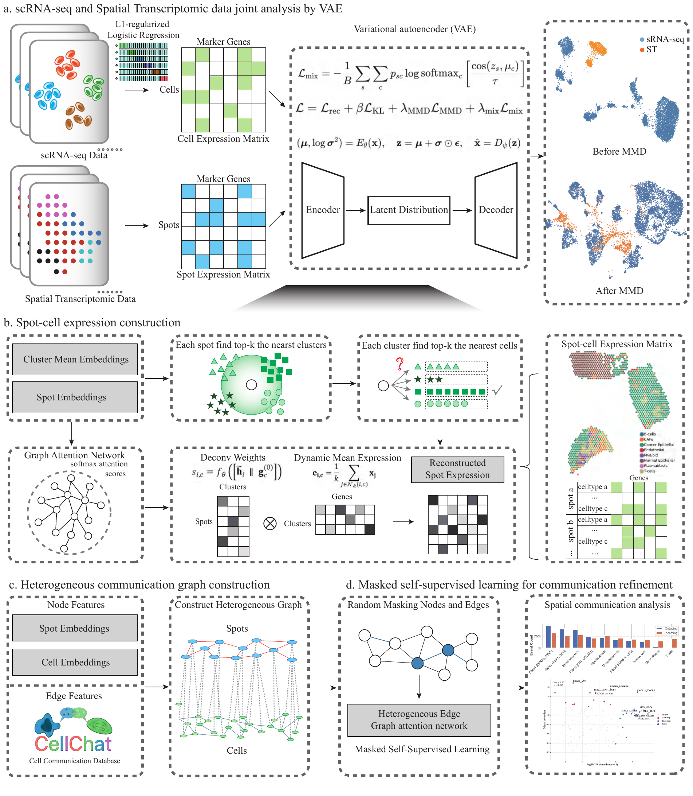
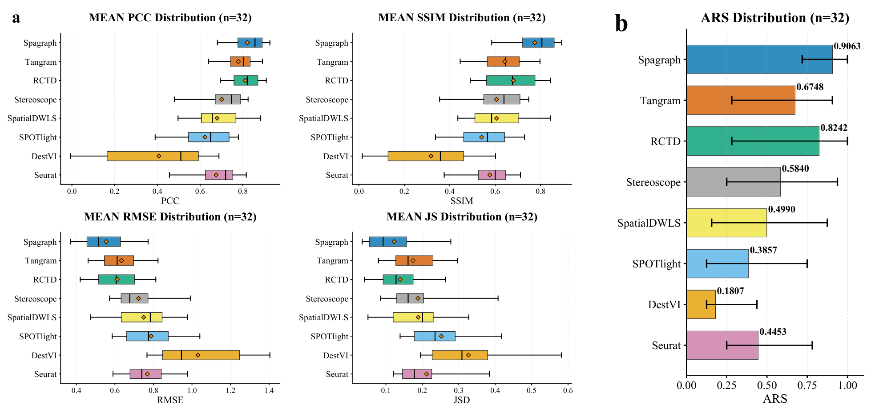

# Spagraph

Spagraph is a three-stage framework for joint single-cell and spatial
transcriptomics analysis. It integrates the two modalities with a variational
autoencoder (Stage 1), estimates spot-level cell composition and reconstructed
expression with a graph attention network (Stage 2), and prioritizes spatial
ligand-receptor communication with a heterogeneous graph model (Stage 3).



## Key features

- **Mixture-aware alignment** uses known cell-type proportions in simulated pseudo-spots to supervise single-cell and spatial alignment.
- **Adaptive graph construction** uses auto-k to select the number of reference prototypes per spot and graph attention to integrate reference and spatial neighbors.
- **Cell-type-specific expression reconstruction** estimates expression for each inferred cell type within a spot for downstream communication analysis.
- **Self-supervised communication prioritization** learns cellular and spatial context by reconstructing masked communication-edge strengths and node features.
- **Configurable consensus ranking** combines evidence across training seeds. The attention weight can be adjusted using saved outputs.

## Benchmark performance

On 32 simulated deconvolution datasets, Spagraph achieved the highest composite average rank score (ARS) among eight methods.



| Metric | Spagraph | RCTD |
|---|---:|---:|
| ARS ↑ | **0.9063** | 0.8242 |
| PCC ↑ | **0.8213** | 0.8110 |
| SSIM ↑ | **0.7744** | 0.6799 |
| RMSE ↓ | **0.5546** | 0.6116 |
| JSD ↓ | **0.1228** | 0.1389 |

## Installation

Spagraph was developed with Python 3.10 and a CUDA-enabled PyTorch environment.
For library use, install the package and its declared dependencies:

```bash
git clone https://github.com/KuangQuanS/Spagraph.git
cd Spagraph
python -m venv .venv
source .venv/bin/activate  # Windows: .venv\Scripts\activate
python -m pip install --upgrade pip
python -m pip install -e .
```

The exact software versions used for the manuscript are pinned in
[`requirements-paper.txt`](requirements-paper.txt). Install the CUDA build of
PyTorch appropriate for your system before installing that file. The looser
ranges in `pyproject.toml` are the supported library dependencies; the pinned
file is for manuscript reproduction.

## Three-stage quick start

```python
from pathlib import Path
import spagraph as spg

sc_file = "data/single_cell.h5ad"
st_file = "data/spatial.h5ad"
deconv_dir = Path("outputs/deconv")
cellcom_dir = Path("outputs/cellcom")

# Stage 1: joint scRNA-seq/ST representation learning.
artifacts = spg.vae(
    sc_file=sc_file,
    st_file=st_file,
    output_dir=str(deconv_dir),
    resolution=4.0,
    lambda_pseudospot_contrastive=0.01,
    mixture_temperature=0.15,
    seed=42,
)

# Stage 2: spatial deconvolution. A list triggers auto-k selection.
deconv_result = spg.deconv(
    vae=artifacts,
    st_file=st_file,
    output_dir=str(deconv_dir),
    k_celltype=[20, 25, 30, 35, 40],
    k_cells_per_cluster=15,
    attention_temperature=4 / 3,
    save_reconstructed_genes=True,
    seed=42,
)

# Stage 3: spatial cell-cell communication.
spg.cellcom(
    deconv_dir=str(deconv_dir),
    st_h5ad=st_file,
    output_dir=str(cellcom_dir),
    n_spot_neighbors=8,
    ligand_expr_threshold=3.0,
    receptor_expr_threshold=3.0,
    epochs=200,
    seed=42,
    n_repeats=5,
    export_unified_csv=False,
)
```

For a more stable final estimate, repeat only Stage 2 while reusing the same
Stage 1 representation:

```python
deconv_result = spg.deconv_ensemble(
    vae=artifacts,
    st_file="data/spatial.h5ad",
    output_dir="results/deconv_ensemble",
    n_repeats=3,
    seeds=[11, 23, 42],
)
```

The returned composition is the simplex-normalized arithmetic mean of the
independent GAT residual predictions. `spg.deconv(...)` remains the faster
single-run API.

Stage 1 returns an in-memory `Stage1Artifacts` object. When `output_dir` is
provided it also writes the run configuration and modality-alignment plots.
Stage 2 writes `*_composition.csv`, configuration and training diagnostics;
`save_reconstructed_genes=True` additionally writes the
`*_spot_cell_expr.csv` file required by Stage 3. Stage 3 writes
`communication_edge_statistics.csv` (unique directed edges and their complete
LR support) and `lr_pair_statistics.csv` (associated-edge attention summaries).
Deprecated unified and filtered LR exports are disabled.

### Pseudo-spot mixture alignment

Stage 1 generates pseudo-spots from annotated single cells, so their cell-type
proportions are known. The shared encoder maps each pseudo-spot and each
cell-type prototype into the latent space. A soft contrastive loss requires
the prototype-similarity distribution to match the known mixture. The
canonical settings are `lambda_pseudospot_contrastive=0.01` and
`mixture_temperature=0.15`. Stage 2 then trains the GAT without signature
initialization or a signature consistency loss and applies an attention
temperature of `4/3` (the validated `gamma=0.75` output calibration). Legacy signature-guided
arguments remain available only for reproducing older ablations.

### Repeated cell-communication analysis

Stage 3 supports `n_repeats` for stochastic stability. `n_repeats=5` trains
five independent models and writes an ensemble LR ranking with score and rank
variation; `n_repeats=1` remains the faster exploratory default. Each run ranks
LR pairs by mean shared attention over unique supporting edges. The ensemble
ranks by the mean within-run attention percentile by default, retaining only
pairs eligible in every requested run. This mode writes
`lr_pair_ensemble_statistics.csv` and `cellcom_ensemble_manifest.json`.
Supply explicit seeds with `spg.cellcom_ensemble(...)`. The default objective
uses edge and node reconstruction with both ranking losses disabled. Repeated
runs assess sensitivity to training randomness, not independent biological
replication or a guaranteed improvement in ranking accuracy.

### Configurable LR consensus ranking

`attention_weight` sets how much of each run's ranking score comes from
context-aware attention:

| `attention_weight` | Interpretation |
|---:|---|
| 1.0 (default) | Attention percentile only |
| 0.75 | 75% attention percentile and 25% supporting-edge percentile |
| 0.5 | Equal weight for both percentiles |
| 0.0 | Supporting-edge percentile only |

For a weight α, each run contributes
`α × attention percentile + (1 − α) × support percentile`.
Support uses the within-run percentile of `log1p(unique supporting-edge count)`.
The per-run scores are averaged across seeds. When α is below 1, pairs need
at least 10 unique supporting edges per run, in addition to existing
eligibility rules. Every ranked pair must be eligible in all runs.

For an attention-led analysis, explore weights from 0.5 to 1.0. A weight
of 0.75 is an empirical starting point that retains a 3:1 emphasis on
attention. See the [matched case-study comparisons](docs/reproduction.md#configurable-lr-consensus-ranking)
for how ranks and leave-one-seed-out stability vary across sections.

For a new multi-seed run, pass `attention_weight=0.75` to
`spg.cellcom_ensemble(...)` and choose a fresh output directory. The weight
affects only the final ranking. To apply a weight to completed runs without
retraining, use the saved per-seed CSVs:

```python
from pathlib import Path
from spagraph.training.cellcom import aggregate_cellcom_seed_outputs

root = Path("outputs/cellcom")
seeds = [11, 23, 42, 67, 101]
dirs = [root / f"seed_{seed}" for seed in seeds]
aggregate_cellcom_seed_outputs(dirs, root, seeds, attention_weight=0.75)
```

The default filenames are `lr_pair_ensemble_statistics.csv` and
`cellcom_ensemble_manifest.json`. Weights below 1 write separate files
tagged with their weight, such as `lr_pair_ensemble_w075_statistics.csv`
for 0.75 or `lr_pair_ensemble_w0p5_statistics.csv` for 0.5.
`ranking_mode="w075"` remains an alias for `attention_weight=0.75`.

#### Support-aware ranking results

For each tissue section, these additional Spagraph rankings reuse the same
five training runs and candidate set at all weights. In HGSOC, 18 of 50
published candidates were rankable among 233 pairs shared by Spagraph,
CellChat and COMMOT. At the top 10% cutoff,
re-ranking at α = 0.75 increased Spagraph's recovery from 3 to 9 of 18 pairs.


[Full rankings, reference recovery and stability across tissues](docs/reproduction.md#configurable-lr-consensus-ranking)

## Inputs and outputs

- Stage 1 inputs: an scRNA-seq `.h5ad` and an ST `.h5ad` with genes as
  variables; the spatial object must contain coordinates in `obsm["spatial"]`.
- Stage 2 input: the Stage 1 artifact plus the ST file. The principal output is
  a spot-by-cluster composition table.
- Stage 3 inputs: the ST file, Stage 2 composition table, reconstructed
  spot-cell expression, and the bundled `cellchat_human.csv` LR database.
- Generated data, checkpoints and manuscript result tables are intentionally
  not versioned. Dataset paths are supplied as command-line arguments in the
  reproduction entry points.

## Repository layout

```text
Spagraph/
├── spagraph/       # Core library (Stage 1 VAE, Stage 2 GAT deconvolution, Stage 3 cell communication)
├── examples/       # Four tumor case studies (cscc, tnbc, dcis, hgsoc) using the public Stage 1–3 API
├── benchmarks/     # Simulated deconvolution, STARmap, seqFISH+, synthetic/semi-synthetic LR, Visium HD, ablations & baselines
├── tests/          # Unit and contract tests
└── docs/           # Manuscript parameter record and reproduction guide
```

## Reproducibility

| Resource | Link |
|---|---|
| Tumor case studies (cSCC, TNBC, DCIS, HGSOC) | [examples/](examples/) |
| Core benchmarks, metrics, ablations & baselines | [benchmarks/](benchmarks/) |
| Manuscript reproduction guide | [docs/reproduction.md](docs/reproduction.md) |
| Parameter record | [docs/parameters.md](docs/parameters.md) |
| Pinned manuscript environment | [requirements-paper.txt](requirements-paper.txt) |
| Full paper reproduction & figure-script archive | [paper-reproduction-20261127](https://github.com/KuangQuanS/Spagraph/tree/paper-reproduction-20261127) |
| Original attention-only release | [v1.0.0](https://github.com/KuangQuanS/Spagraph/tree/v1.0.0) |
| Additional weight analyses | [Consensus ranking comparisons](docs/reproduction.md#configurable-lr-consensus-ranking) |

Historical figure-assembly recipes, per-dataset intermediate logs, and legacy notebooks remain preserved without rewriting history in the [`paper-reproduction-20261127`](https://github.com/KuangQuanS/Spagraph/tree/paper-reproduction-20261127) and [`v1.0.0`](https://github.com/KuangQuanS/Spagraph/tree/v1.0.0) tags.

## License

Spagraph is released under the [MIT License](LICENSE).
