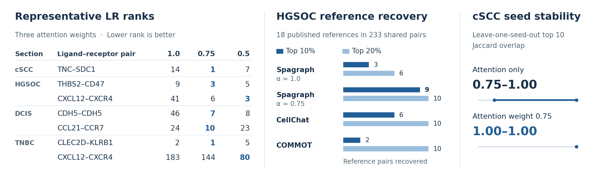

# Spagraph

Spagraph is a three-stage framework for joint single-cell (scRNA-seq) and spatial
transcriptomics (ST) analysis. It integrates both modalities with a variational
autoencoder (**Stage 1**), estimates spot-level cell composition and cell-type-specific
gene expression with a graph attention network (**Stage 2**), and prioritizes spatial
ligand–receptor communication with a heterogeneous graph model (**Stage 3**).


## Key features

- **Mixture-aware alignment (Stage 1):** Uses known cell-type proportions in simulated pseudo-spots to supervise joint scRNA-seq/ST latent alignment.
- **Adaptive GAT deconvolution (Stage 2):** Uses auto-k prototype selection and graph attention to combine reference and spatial neighborhoods, reconstructing cell-type-specific expression for downstream communication analysis.
- **Spatial cell–cell communication (Stage 3):** Learns cellular and spatial context via masked edge/node reconstruction using the bundled human CellChat ligand–receptor database (`spagraph/cellcom/cellchat_human.csv`).
- **Configurable multi-seed consensus ranking:** Combines attention and edge-support percentiles across training seeds (`attention_weight` in `[0, 1]`), reusable on saved per-seed outputs without retraining.

## Benchmark performance

Across 32 simulated deconvolution datasets, Spagraph achieved the highest composite
average rank score (ARS) among eight evaluated methods:


| Metric | Spagraph | RCTD |
|---|---:|---:|
| ARS ↑ | **0.9063** | 0.8242 |
| PCC ↑ | **0.8213** | 0.8110 |
| SSIM ↑ | **0.7744** | 0.6799 |
| RMSE ↓ | **0.5546** | 0.6116 |
| JSD ↓ | **0.1228** | 0.1389 |

## Installation

Spagraph targets **Python 3.10+** with a CUDA-enabled PyTorch environment:

```bash
git clone https://github.com/KuangQuanS/Spagraph.git
cd Spagraph
python -m venv .venv
source .venv/bin/activate  # Windows: .venv\Scripts\activate
python -m pip install --upgrade pip
python -m pip install -e .
```

For the exact pinned software versions used in the manuscript, install the CUDA
build of PyTorch matching your system and then run
`pip install -r requirements-paper.txt`.

## Tutorial: Three-stage workflow

### Input data requirements

> **Important:** Both `sc_file` and `st_file` must store **raw, unnormalized counts** in `adata.X`. Stage 1 computes library-size ratios from raw counts and runs `normalize_total(target_sum=1e4)` and `log1p` internally—do **not** pass pre-normalized, log-transformed, or z-scored matrices.

- **scRNA-seq (`.h5ad`):**
  - `adata.X`: raw UMI/read counts (cells × genes).
  - `adata.var_names`: gene names using the same naming convention as the ST object (human gene symbols are required for the bundled Stage 3 `cellchat_human.csv` database).
  - `adata.obs`: reference cell-type labels in `cell_type` or `celltype` (auto-detected), or specify another column via `celltype_key="..."`.
- **Spatial transcriptomics (`.h5ad`):**
  - `adata.X`: raw counts (spots × genes).
  - `adata.var_names`: gene names matching `sc_file` (Stage 1 automatically takes the shared gene intersection).
  - `adata.obsm["spatial"]`: 2D spatial coordinates (`n_spots × 2`).

### Quick start

```python
from pathlib import Path
import spagraph as spg

sc_file = "data/single_cell.h5ad"
st_file = "data/spatial.h5ad"
deconv_dir = Path("outputs/deconv")
cellcom_dir = Path("outputs/cellcom")

# Stage 1: Joint scRNA-seq / ST representation learning
artifacts = spg.vae(
    sc_file=sc_file,
    st_file=st_file,
    output_dir=str(deconv_dir),
    resolution=4.0,
    top_n_per_type=100,
    lambda_pseudospot_contrastive=0.01,
    mixture_temperature=0.15,
    seed=42,
)

# Stage 2: Spatial deconvolution (a list enables auto-k selection)
deconv_result = spg.deconv(
    vae=artifacts,
    st_file=st_file,
    output_dir=str(deconv_dir),
    k_celltype=[20, 25, 30, 35, 40],
    k_cells_per_cluster=15,
    attention_temperature=4 / 3,
    scale_basis="all",
    save_reconstructed_genes=True,  # Required by Stage 3
    seed=42,
)

# Stage 3: Spatial cell–cell communication (5-seed consensus)
spg.cellcom(
    deconv_dir=str(deconv_dir),
    st_h5ad=st_file,
    output_dir=str(cellcom_dir),
    n_spot_neighbors=8,
    ligand_expr_threshold=3.0,
    receptor_expr_threshold=3.0,
    lr_score_threshold=1.0,
    allow_same_celltype_comm=True,
    epochs=200,
    seeds=[11, 23, 42, 67, 101],
    export_unified_csv=False,
)
```

### Main outputs

- **Stage 1:** Returns an in-memory `Stage1Artifacts` object and writes `config_vae.txt` plus modality-alignment plots when `output_dir` is set.
- **Stage 2:** Writes `*_composition.csv`, `config_deconv.txt`, training diagnostics, and (when `save_reconstructed_genes=True`) `*_spot_cell_expr.csv`.
- **Stage 3:** Writes `communication_edge_statistics.csv` (unique directed edges with complete LR support) and `lr_pair_statistics.csv` per run, plus `lr_pair_ensemble_statistics.csv` and `cellcom_ensemble_manifest.json` for multi-seed runs.

### Optional Stage 2 ensemble

Repeat only Stage 2 while reusing the same Stage 1 representation:

```python
deconv_result = spg.deconv_ensemble(
    vae=artifacts,
    st_file=st_file,
    output_dir="outputs/deconv_ensemble",
    n_repeats=3,
    seeds=[11, 23, 42],
)
```

### Configurable Stage 3 consensus ranking (`attention_weight`)

In multi-seed Stage 3 runs, each run scores eligible LR pairs by
`α × attention percentile + (1 − α) × log1p(supporting edges) percentile`,
averaged across seeds:

| `attention_weight` (α) | Meaning | Output file |
|---:|---|---|
| `1.0` (default) | Attention percentile only | `lr_pair_ensemble_statistics.csv` |
| `0.75` (`ranking_mode="w075"`) | 75% attention + 25% edge support (≥10 edges/run) | `lr_pair_ensemble_w075_statistics.csv` |
| `0.5` | Equal attention and support weight (≥10 edges/run) | `lr_pair_ensemble_w0p5_statistics.csv` |

Pass `attention_weight=0.75` directly to `spg.cellcom(...)` / `spg.cellcom_ensemble(...)`,
or re-rank saved per-seed runs without retraining:

```python
from pathlib import Path
from spagraph.training.cellcom import aggregate_cellcom_seed_outputs

root = Path("outputs/cellcom")
seeds = [11, 23, 42, 67, 101]
dirs = [root / f"seed_{s}" for s in seeds]
aggregate_cellcom_seed_outputs(dirs, root, seeds, attention_weight=0.75)
```



## Tumor case-study examples

Four ready-to-run Stage 1–3 scripts under [`examples/`](examples/) implement
the tumor case studies with their exact manuscript parameters (Stage 1:
`resolution=4.0`, `top_n_per_type=100`, `lambda_pseudospot_contrastive=0.01`,
`mixture_temperature=0.15`, `seed=42`; Stage 2: `k_cells_per_cluster=15`,
`attention_temperature=4/3`, `scale_basis="all"`; Stage 3: `n_spot_neighbors=8`,
`ligand/receptor_expr_threshold=3.0`, `epochs=200`, `seeds=[11, 23, 42, 67, 101]`):

| Case study | Script | Dataset | Stage 2 `k_celltype` | Stage 3 `batch_size` |
|---|---|---|---:|---:|
| cSCC (P2) | [`examples/cscc/run.py`](examples/cscc/run.py) | GSE144236 + GSE144239 | `40` | `96` |
| TNBC | [`examples/tnbc/run.py`](examples/tnbc/run.py) | CID44971 | `[20, 30, 40]` | `128` |
| DCIS | [`examples/dcis/run.py`](examples/dcis/run.py) | GSE243275 | `20` | `64` |
| HGSOC (P3) | [`examples/hgsoc/run.py`](examples/hgsoc/run.py) | GSE211956 | `[20, 30, 40]` | `128` |

The cSCC example includes a one-command downloader for compact `v1.0.0` release inputs:

```bash
python examples/cscc/download.py
python examples/cscc/run.py
```

All four scripts accept `--sc-file`, `--st-file`, `--output-dir`, `--device`,
`--k-celltype`, `--seeds`, `--attention-weight`, and `--skip-cellcom`. See
[`examples/README.md`](examples/README.md) for details.

## Repository layout

```text
Spagraph/
├── spagraph/               # Core Python package (Stage 1 VAE, Stage 2 GAT, Stage 3 CellCom)
├── examples/               # Four tumor case studies (cscc, tnbc, dcis, hgsoc)
├── assets/                 # Figures displayed in this README
├── README.md               # Installation, tutorial, parameters, and case-study guide
├── pyproject.toml          # Package metadata and dependencies
├── requirements.txt        # Runtime dependencies
└── requirements-paper.txt  # Pinned manuscript environment
```

## Paper reproduction archive

To keep `main` focused on the core software and clean examples, all manuscript
benchmark runners (32 simulated datasets, STARmap, seqFISH+, synthetic and
semi-synthetic LR benchmarks, Visium HD CRC), statistical audits, ablations,
baseline workflows, parameter records, and figure-assembly scripts are archived
in tagged snapshots:

- **Full manuscript reproduction archive:** [`paper-reproduction-20261127`](https://github.com/KuangQuanS/Spagraph/tree/paper-reproduction-20261127)
- **Original v1.0.0 release:** [`v1.0.0`](https://github.com/KuangQuanS/Spagraph/tree/v1.0.0)

## License

Spagraph is released under the [MIT License](LICENSE).
